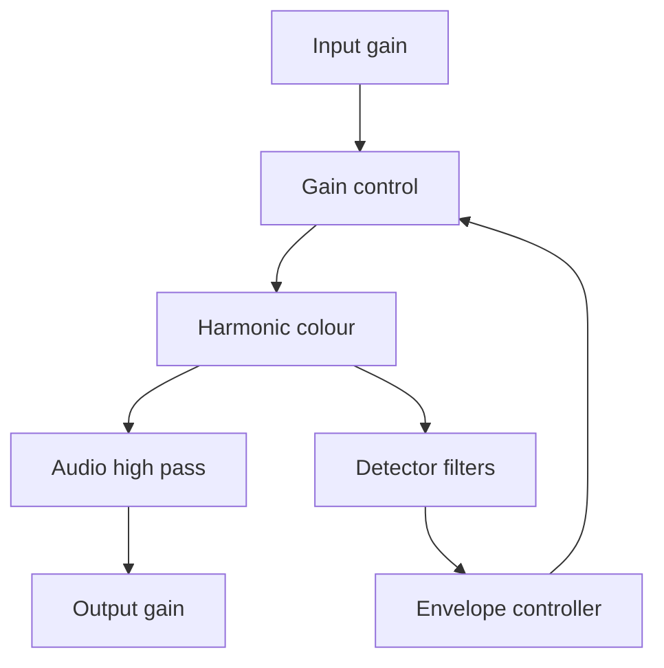

# Model provenance — 30 October 2026

## Verified primary reference

Empirical Labs, *Distressor Classic Knee Compression* user manual:
https://www.empiricallabs.com/wp-content/uploads/distressor_manual.pdf

The printed page 6 contains the block diagram. It shows a feedback
detector tap after the distortion generator and before the audio high pass. The audio
HP and output amplifier follow. Detector filtering is a separate branch.
This primary drawing determined the topology in `Source/CompressorCore.h`.

The manual describes ratio-dependent response and selectable harmonics. Its
attack/release limits guide the user control ranges, rather than providing
electrical RC values. The manual does not establish this implementation's
thresholds, equations, or measured transient responses.

## Search leads, not verified electrical evidence

An original reverse-engineering author posted rough drawings in this thread:
https://groupdiy.com/threads/distressor-vs-1176.117/

Image links cited there:

- http://www.telusplanet.net/public/dulan/distressor1.jpg
- http://www.soulset.de/distressor2.JPG

Neither image was accessible during this work. The author described missing
sections and uncertainty in component values. No image was inspected or used
as a netlist. Forum interpretations of the gain-control device are not treated
as verified manufacturer specifications. No patent found in this search was
verified as an EL8 electrical schematic.

## Actual implementation

The detector reads the previous post-colour sample, giving one internal
oversampled-sample causal delay. A maximum rectified detector target links
stereo channels. This is an intentional software stereo-link design, not an
electrical reconstruction of the hardware link jacks.

For detector level L, threshold T, and loop gain k = R-1:

- Hard knee target: `gTarget = k * max(0, L-T)`.
- Inside a knee width W: replace max with `(L-T+W/2)^2/(2W)`.
- Controller: `g += (1-exp(-1/(fs*tau*R))) * (gTarget-g)`.
- Audio gain: `10^(-g/20)`.

At steady state above the knee with an unfiltered DC test,
`g=(R-1)*(x-g-T)`, giving output `T+(x-T)/R`. This is why the feedback
coefficient uses R-1, rather than the feed-forward coefficient 1-1/R.
The R factor stabilizes the discrete loop and normalizes local response speed.
These equations are our design, not an inferred transistor model.

| Stage | Implementation | Evidence level |
|---|---|---|
| Stage order / detector tap | Feedback, after colour and before audio HP | Official block drawing |
| Gain-control element | Scalar exponential gain | Functional approximation |
| Threshold and knee | Table in `modes`, dBFS | Estimated; no hardware calibration |
| 10:1 recovery | Smoothed reduction memory slows release | Estimated optical-style response |
| Crush recovery | Release slows with increasing reduction | Estimated curved recovery |
| British | Lower threshold, 20:1, narrow knee | Estimated; not the exact EL8-X modification |
| H2 | Offset tanh with DC removal | Estimated even-harmonic generator |
| H3 | Symmetric tanh | Estimated odd-harmonic generator |
| Detector HP | 90 Hz second-order high pass | Corner/order chosen for prototype |
| Detector emphasis | 6 kHz, +8 dB, Q=1 | Centre guided by manual; width/boost estimated |
| Audio HP | 80 Hz second-order high pass | Centre guided by manual; order estimated |
| Oversampling | JUCE 4x linear-phase FIR | Software addition |
| Input/output reference | dBFS gains | Software addition; no analog dBu calibration |

No op-amp slew model, JFET equation, supply-rail simulation, component tolerance,
physical optical cell, analog noise floor, measured THD lamps, or exact switch
resistor network is asserted. The interface meters reduction and digital peak
level only. In particular, the gain-control block label in the manual is not
evidence of a particular integrated VCA or FET part number.

## Calibration required for a closer emulation

Obtain an authenticated schematic, or measure a hardware unit at documented
input/output calibration. Capture steady transfer curves at every ratio,
level steps for attack/recovery at multiple knob positions, two-tone and sine
harmonics versus level and gain reduction, and detector/audio filter sweeps.
Fit the exposed estimates against those data; reserve separate measurements
for validation. A schematic alone still cannot establish pot laws, device
tolerances, factory trim, and the particular unit's final response.

## 0.2.0 topology correction

Direct visual inspection of the manufacturer block diagram found the detector
branch at the distortion-generator output, before audio HP. Version 0.1.0
incorrectly placed this branch before colour. Version 0.2.0 fixes the tap and
orders the detector emphasis before the sidechain HP as drawn. Colour can now
change the feedback detector level. The one internal sample of delay makes the
loop causal; at 4x oversampling this is 1/(4*hostSampleRate) seconds.
